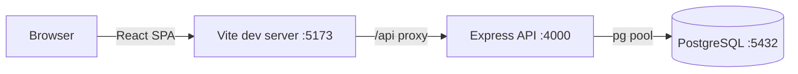

# Wildlife Conservation Management System


A full-stack **Wildlife Conservation Management System** that lets conservation teams monitor, record and analyse species, individual animals, habitats, protected areas, field sightings, incidents, threats, rangers, conservation programmes, wildlife rescues, animal health and research — all backed by a **PostgreSQL** database exposed through a **REST API**.

The project is built as an academic **DBMS (Database Management Systems)** project and demonstrates a real relational data model, a typed service layer, and a modern React front-end with live analytics.

---

## Table of Contents

- [Overview](#overview)
- [Group Members](#group-members)
- [Features](#features)
- [Tech Stack](#tech-stack)
- [Architecture](#architecture)
- [Modules & API](#modules--api)
- [Backend REST API](#backend-rest-api)
- [Database Schema](#database-schema)
- [Reports](#reports)
- [Dashboard Analytics](#dashboard-analytics)
- [Design & UX](#design--ux)
- [Project Structure](#project-structure)
- [Getting Started](#getting-started)
- [Environment Variables](#environment-variables)
- [Available Scripts](#available-scripts)
- [Known Limitations](#known-limitations)
- [License](#license)

---

## Overview

The application is split into two runnable parts:

- **Front-end** (`wildlife-app/`) — a React 19 + TypeScript single-page app (Vite) with a dashboard, 13 data modules, reports, a public landing page, and settings/help/profile pages.
- **Backend** (`wildlife-app/server/`) — an Express + `pg` REST API that serves every module from a PostgreSQL database, plus dedicated aggregate endpoints for the dashboard.

All CRUD operations, dashboard charts and report exports are driven by live database data — there is no mock data in the running application.

---

## Group Members

| Name | Roll Number |
|------|-------------|
| Kashinadh Nair | AM.SC.U4CSE25127 |
| Harishankar J | AM.SC.U4CSE25122 |
| Sreegovind E J | AM.SC.U4CSE25152 |
| Mohammad Rahan | AM.SC.U4CSE25161 |

---

## Features

### Monitoring & Registry

- **Species Registry** — taxonomy (common + scientific name), category, IUCN-style conservation status, population estimate, habitat, body length, weight, diet, regions, imagery and descriptions.
- **Animal Tracking** — individual animals linked to a species, with gender, age, date of birth, habitat, health status, current location and tracking status.
- **Habitat Management** — habitat type, location, area, condition, species count, last inspection and description.
- **Protected Areas** — national parks, sanctuaries, tiger reserves and biosphere reserves with area size, ranger count, species count, status and establishment year.

### Field Operations

- **Sightings** — log and verify observations with species, protected area, location, habitat, date/time, ranger, count, behaviour, status and notes. Includes one-click **CSV export**.
- **Incidents** — poaching, forest fire, injured animal, habitat destruction, human-wildlife conflict and more, with severity and Open / Investigating / Resolved workflow.
- **Threats** — threat type, affected species, location, severity, status and trend (Rising / Stable / Declining).
- **Rescue Operations** — rescue case log with rescue team, condition, outcome (Released / Under Treatment / Transferred / Deceased) and status.
- **Animal Health** — examinations with veterinarian, condition, treatment, medication, follow-up date and notes.

### Workforce & Programmes

- **Rangers** — personnel with assigned area, contact, duty status, active assignments, join year and specialisation.
- **Conservation Activities** — programmes such as habitat restoration, anti-poaching patrols, species monitoring, tree plantation and breeding, with progress %, status and budget.
- **Researchers** — researchers with organisation, specialisation, active projects, status and focus areas.

### Analytics & Reporting

- **Dashboard** — live statistics and interactive charts (sightings trend, species population, incident breakdown, activity status) plus a recent-activity feed and quick actions.
- **Reports** — a catalogue of 8 reports that can be previewed, **generated from live data**, and **exported to CSV**.
- **Global Search** — search across multiple modules from the top navigation.

### Experience

- Public marketing **landing page** with live headline statistics.
- Monochrome ("black & white") design system with **dark mode**, responsive layout, skeletons, toasts, modals, confirm dialogs and empty/error states.
- **Help** and **Settings** / **Profile** pages, plus a custom 404 route.

---

## Tech Stack

### Front-end

| Concern | Technology |
|---------|------------|
| Framework | React 19 + TypeScript |
| Build tool | Vite 8 |
| Routing | React Router DOM v7 |
| Styling | Tailwind CSS v3 |
| Charts | Recharts |
| Icons | Lucide React |
| Linting | Oxlint |
| Data access | Typed `fetch` service layer (`src/lib/api.ts`) |

### Backend

| Concern | Technology |
|---------|------------|
| Runtime | Node.js + TypeScript (run with `tsx`) |
| Web framework | Express 4 |
| Database driver | `pg` (node-postgres) |
| Database | PostgreSQL |
| Config | `dotenv` |
| CORS | `cors` |

---

## Architecture



- The React app calls `/api/*`. In development Vite proxies `/api` to the Express server on port `4000` (`vite.config.ts`).
- The Express server opens PostgreSQL connections lazily on the first request.
- A shared generic CRUD router plus a dedicated dashboard router serve all endpoints.

---

## Modules & API

Every module is exposed at `/api/<resource>` and maps to one PostgreSQL table. Client-side IDs use the given prefixes.

| Module | Route | Table | ID prefix |
|--------|-------|-------|-----------|
| Species | `/api/species` | `species` | `SP-` |
| Animals | `/api/animals` | `animals` | `AN-` |
| Habitats | `/api/habitats` | `habitats` | `HB-` |
| Protected Areas | `/api/protected-areas` | `protected_areas` | `PA-` |
| Sightings | `/api/sightings` | `sightings` | `SG-` |
| Incidents | `/api/incidents` | `incidents` | `IN-` |
| Threats | `/api/threats` | `threats` | `TH-` |
| Rangers | `/api/rangers` | `rangers` | `RG-` |
| Conservation Activities | `/api/conservation-activities` | `conservation_activities` | `AC-` |
| Rescue Operations | `/api/rescue-operations` | `rescue_operations` | `RS-` |
| Animal Health | `/api/animal-health` | `animal_health` | `HT-` |
| Researchers | `/api/researchers` | `researchers` | `RS-` |
| Reports | `/api/reports` | `reports` | `RP-` |

---

## Backend REST API

### Generic CRUD contract

Every resource shares the same contract:

| Method | Path | Description |
|--------|------|-------------|
| `GET` | `/api/:resource` | List all records |
| `GET` | `/api/:resource/:id` | Fetch one record (`404` when missing) |
| `POST` | `/api/:resource` | Create a record (client may supply `id`) |
| `PATCH` | `/api/:resource/:id` | Partial update |
| `PUT` | `/api/:resource/:id` | Partial update (alias) |
| `DELETE` | `/api/:resource/:id` | Delete a record |

### Dashboard endpoints

| Method | Path | Returns |
|--------|------|---------|
| `GET` | `/api/dashboard/stats` | Headline totals + trend |
| `GET` | `/api/dashboard/sightings-overview` | Sightings per month (total vs verified) |
| `GET` | `/api/dashboard/species-population` | Population estimate per species |
| `GET` | `/api/dashboard/incident-categories` | Incident counts by category |
| `GET` | `/api/dashboard/activity-status` | Conservation programme counts by status |
| `GET` | `/api/dashboard/activity-feed` | Recent cross-module activity |

### Utility

| Method | Path | Description |
|--------|------|-------------|
| `GET` | `/api/health` | Service health probe |

### Error handling

Database and validation errors are mapped to safe HTTP responses:

- `23503` foreign-key violation → `409`
- `23505` unique violation → `409`
- `23514` check-constraint violation → `400`
- `23502` not-null violation → `400`
- connection errors → `503`

All queries are parameterised.

---

## Database Schema

The schema lives in `wildlife-app/server/db/schema.sql` and is **idempotent and non-destructive** (`CREATE TABLE IF NOT EXISTS` only — it never drops or truncates data).

**Tables:** `species`, `animals`, `habitats`, `protected_areas`, `sightings`, `incidents`, `threats`, `rangers`, `conservation_activities`, `rescue_operations`, `animal_health`, `researchers`, `reports`.

**Relationships (foreign keys, all `ON DELETE SET NULL`):**

- `animals.species_id → species.id`
- `sightings.species_id → species.id`
- `sightings.protected_area_id → protected_areas.id`
- `rescue_operations.animal_id → animals.id`
- `animal_health.animal_id → animals.id`

**Data integrity:** `CHECK` constraints enforce valid enum values (e.g. conservation status, severity, status) and non-negative counters; common lookup columns are indexed (`date`, `species_id`, `protected_area_id`, `animal_id`).

---

## Reports

The Reports module (`/reports`) surfaces 8 reports, each sourced from its corresponding live table:

| ID | Report | Source |
|----|--------|--------|
| RP-01 | Wildlife Population Report | `species` |
| RP-02 | Species Conservation Report | `species` |
| RP-03 | Wildlife Sightings Report | `sightings` |
| RP-04 | Conservation Incident Report | `incidents` |
| RP-05 | Threat Analysis Report | `threats` |
| RP-06 | Habitat Report | `habitats` |
| RP-07 | Rescue Operations Report | `rescue_operations` |
| RP-08 | Conservation Activities Report | `conservation_activities` |

- **Export** downloads the full record set for a report as a **CSV** file, generated in the browser from live API data (values containing commas/quotes are properly escaped).
- **Generate** fetches the current rows, builds a formatted text report, and shows it in the report preview.

There is no server-side export/generate endpoint; both operations run client-side against the live REST API and perform **no database writes**.

---

## Dashboard Analytics

The dashboard (`/dashboard`) is fully API-driven:

- **Stat cards** — total species, animals, protected areas, active sightings, open incidents and conservation activities.
- **Charts** — sightings overview (line), species population (bar), incident categories (donut) and conservation activity status (horizontal bar).
- **Recent activity feed** — latest actions aggregated across modules.
- **Quick actions** linking to the record-creation flows.

The public landing page also displays live headline statistics.

---

## Design & UX

- Clean monochrome (black & white) design system built on Tailwind CSS.
- **Light and dark themes** with a persisted toggle.
- Responsive layout with a collapsible sidebar and mobile navigation.
- Reusable UI primitives: data tables, modal dialogs, toasts, confirmation dialogs, skeletons, empty states, error/retry panels, status badges and search/filter bars.

---

## Project Structure

```
wildlife/
├── README.md                     # This file
└── wildlife-app/
    ├── index.html
    ├── package.json
    ├── vite.config.ts            # /api proxy -> http://localhost:4000
    ├── tailwind.config.js
    ├── src/
    │   ├── components/           # Reusable UI (tables, modals, toast, charts, ...)
    │   ├── config/               # Navigation and image config
    │   ├── hooks/                # useAsyncData, useDebounce, useTheme
    │   ├── layout/               # App shell: navbar, sidebar, footer, global search
    │   ├── lib/
    │   │   ├── api.ts            # Typed REST client
    │   │   └── format.ts         # Date/number/export helpers
    │   ├── pages/                # Landing, Dashboard, 13 modules, Reports, Help, Settings, Profile
    │   ├── services/             # One typed service per module (calls the REST API)
    │   └── types/                # Shared TypeScript domain types
    └── server/
        ├── package.json
        ├── .env.example          # Copy to .env and configure
        ├── db/
        │   ├── schema.sql        # Idempotent PostgreSQL schema
        │   ├── migrate.ts        # Apply schema
        │   ├── seed.ts           # Load sample data
        │   └── check.ts          # Connectivity/row-count check
        └── src/
            ├── index.ts          # Express app + route mounting
            ├── config.ts         # Environment configuration
            ├── db.ts             # Lazy pg pool
            ├── http.ts           # Error mapping
            ├── resources.ts      # Resource registry (table/column mapping)
            └── routes/
                ├── crud.ts       # Generic CRUD router
                └── dashboard.ts  # Aggregate dashboard endpoints
```

---

## Getting Started

### Prerequisites

- **Node.js** 20+ and npm
- **PostgreSQL** 14+ running locally

### 1. Clone

```bash
git clone https://github.com/kashinadhnair95978-netizen/Wildlife-Conservation-Management.git
cd Wildlife-Conservation-Management
```

### 2. Backend setup

```bash
cd wildlife-app/server
npm install
```

Create your environment file and set the PostgreSQL credentials:

```bash
copy .env.example .env      # Windows
# cp .env.example .env      # macOS / Linux
```

Create the database (once), then apply the schema and seed sample data:

```bash
# If the database does not exist yet:
createdb wildlife           # or: psql -U postgres -c "CREATE DATABASE wildlife;"

npm run db:setup            # runs migrate + seed
```

Start the API:

```bash
npm run dev                 # http://localhost:4000
```

### 3. Front-end setup

In a second terminal:

```bash
cd wildlife-app
npm install
npm run dev                 # http://localhost:5173
```

Open **http://localhost:5173** — the dashboard and every module now read live data from PostgreSQL.

---

## Environment Variables

Configured in `wildlife-app/server/.env` (see `.env.example`):

| Variable | Default | Description |
|----------|---------|-------------|
| `PORT` | `4000` | API server port |
| `CORS_ORIGIN` | `http://localhost:5173` | Allowed browser origin |
| `DATABASE_URL` | — | Optional single connection string (takes precedence) |
| `PGHOST` | `localhost` | PostgreSQL host |
| `PGPORT` | `5432` | PostgreSQL port |
| `PGUSER` | `postgres` | PostgreSQL user |
| `PGPASSWORD` | `postgres` | PostgreSQL password |
| `PGDATABASE` | `wildlife` | Database name |

> `.env` is git-ignored — never commit real credentials.

---

## Available Scripts

### Front-end (`wildlife-app/`)

| Script | Description |
|--------|-------------|
| `npm run dev` | Start the Vite dev server |
| `npm run build` | Type-check and build for production |
| `npm run preview` | Preview the production build |
| `npm run lint` | Run Oxlint |

### Backend (`wildlife-app/server/`)

| Script | Description |
|--------|-------------|
| `npm run dev` | Start the API with watch mode |
| `npm start` | Start the API |
| `npm run typecheck` | Type-check the backend |
| `npm run migrate` | Apply the database schema |
| `npm run seed` | Load sample data |
| `npm run db:setup` | `migrate` + `seed` |
| `npm run db:check` | Connectivity and row-count check |

---

## Known Limitations

- The `species-population` dashboard endpoint derives numbers by stripping non-digits from population-estimate strings; range values such as `"12,000 - 14,000"` are concatenated (`1200014000`). This is a backend parsing quirk; the front-end renders the value as returned.
- The sightings-overview chart shows a single month because all seeded sightings fall in the same month.
- Report generation and CSV export run in the browser from live API data; there is no server-side report-persistence endpoint.
- There is no authentication/authorisation layer — the app is intended for local/academic use.

---

## License

Developed for educational purposes as part of a DBMS course project.
